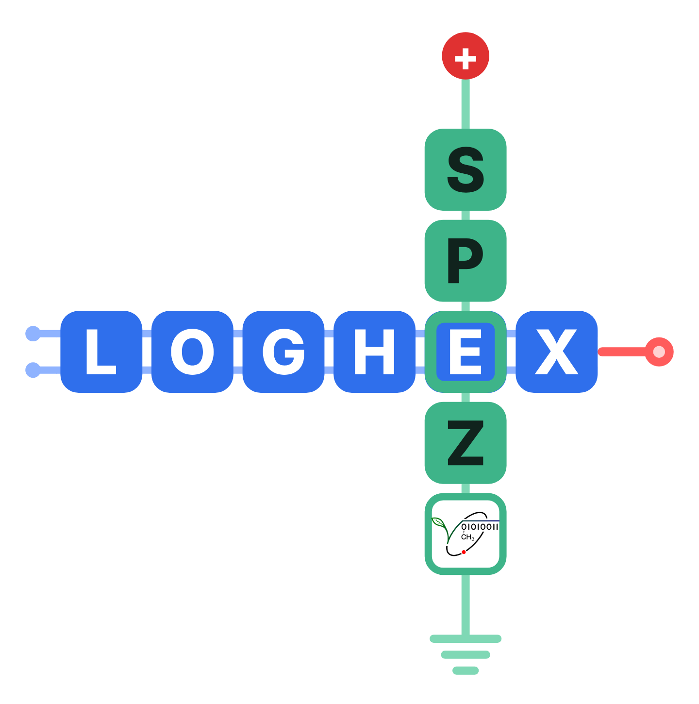

<p align="center">
  
</p>

<h1 align="center">LOGHEX</h1>

<p align="center">
  <b>Simulation von Logikgattern, Halbleiterschaltungen und einem Von-Neumann-Rechner für den Informatikunterricht</b><br>
  MINT-Spezialklassen am Albert-Schweitzer-Gymnasium Erfurt · <a href="https://www.asgspez.de">www.asgspez.de</a>
</p>

<p align="center">
  <a href="https://loghex.asgspez.de"><b>▶ LOGHEX im Browser starten</b></a> ·
  <a href="material/LOGHEX-Handbuch.pdf">Handbuch (PDF)</a> ·
  <a href="#lizenz">Lizenz</a>
</p>

---

LOGHEX ist eine Lernumgebung, in der Schülerinnen und Schüler Schaltungen selbst aufbauen, testen und verstehen – vom einzelnen Gatter über Transistoren bis zu einem vollständigen 8-Bit-Rechner, der in einer eigenen Hochsprache programmiert werden kann.

Das gesamte Programm steckt in **einer einzigen HTML-Datei**. Es braucht keine Installation, kein Konto und keine Internetverbindung, und es speichert keine Daten außerhalb des Geräts.

## Die vier Bereiche

| Reiter | Inhalt |
|---|---|
| **Logikgatter** | AND, OR, NOT, NAND, NOR, XOR, Flipflops, Zähler, Addierer, Multiplexer, Siebensegmentanzeige u. v. m. Eigene Bausteine lassen sich aus Schaltungen bauen und wiederverwenden; per Doppelklick sieht man ihren inneren Aufbau. Wahrheitstabellen werden automatisch erzeugt. |
| **Elektronik & Halbleiter** | Analoge Simulation mit Spannungsquellen, Widerständen, Dioden, LEDs, Transistoren, Kondensatoren und Messgeräten. Gatter lassen sich aus Transistoren nachbauen. |
| **Halbleiter-Modell** | Anschauliches Teilchenmodell des pn-Übergangs: Dotierung, Sperrschicht, Durchlass- und Sperrrichtung. |
| **Rechner** | 8-Bit-Rechner nach dem Von-Neumann-Prinzip mit Adress-, Daten- und Steuerbus, Mikroschritt-Anzeige und Assembler. Jedes Bauteil (ALU, Register, Steuerwerk …) lässt sich per Doppelklick auf Gatterebene öffnen und testen. |

### Pseudocode-Compiler mit Compiler-Labor

Im Rechner gibt es eine einfache Hochsprache mit englischen Schlüsselwörtern (`if`, `while`, `for`, Arrays, Prozeduren …), die nach Assembler übersetzt wird. Im **Compiler-Labor** kann man Schritt für Schritt zusehen, wie

1. der **Lexer** den Quelltext in Tokens zerlegt (inklusive Abgleich mit der Schlüsselworttabelle),
2. der **Parser** daraus den Syntaxbaum aufbaut (mit Grammatik und Aufrufstapel) und
3. die **Codeerzeugung** den Baum in Maschinenbefehle übersetzt (mit Stapel-Darstellung).

Ein **Vorhersage-Modus** lässt die Lernenden den jeweils nächsten Schritt selbst vorhersagen.

### Weitere Besonderheiten

- Bedienung mit Maus **und** Touch, optimiert für das iPad
- Aufgabenmodus für Lehrkräfte: Aufgaben mit automatischer Überprüfung erstellen und verteilen
- Schaltungen als Datei speichern, laden oder als Link teilen
- **Yenka-Dateien (`.yka`) öffnen:** Logikschaltungen (Gatter nach IC-Nummer, eigene Blöcke werden zu Bausteinen) und Elektronikschaltungen werden übernommen und lassen sich weiter simulieren
- Export von Schaltbildern als Bild (PNG) oder Vektorgrafik (SVG)
- 78 Beispielschaltungen, 17 Assembler- und 10 Pseudocode-Programme als separate Dateien – das Programm selbst startet bewusst leer, damit die Schüler selbst entwickeln

## Benutzung

### Im Browser / auf dem iPad

**<https://loghex.asgspez.de>** in Safari öffnen und über *Teilen → Zum Home-Bildschirm* als App ablegen. Nach dem ersten Aufruf läuft LOGHEX auch ohne Internet.

> **Hinweis:** Auf dem iPad lässt sich die Datei `LOGHEX.html` nicht direkt öffnen – iPadOS zeigt lokale HTML-Dateien nur als Vorschau ohne JavaScript an. Deshalb die Web-Adresse verwenden.

### Offline unter Windows, macOS oder Linux

[`LOGHEX.html`](material/LOGHEX.html) herunterladen und doppelt anklicken. Die Datei öffnet sich im Standardbrowser (Edge, Chrome, Firefox oder Safari).

### Auf einem eigenen Server

Das Paket `LOGHEX-Server.zip` enthält alles für den Betrieb unter einer eigenen Adresse: Programm, App-Symbole, Web-App-Manifest, Service Worker für den Offline-Betrieb und eine `.htaccess` für Apache. Die beiliegende `ANLEITUNG.txt` beschreibt die Einrichtung. Voraussetzung ist HTTPS.

## Inhalt des Repositorys

```
├── index.html               Programm (Server-Fassung)
├── sw.js                    Service Worker für den Offline-Betrieb
├── manifest.webmanifest     App-Name und Symbole für den Home-Bildschirm
├── icons/                   App-Symbole
├── material/
│   ├── LOGHEX.html          Offline-Fassung (eine Datei, Doppelklick genügt)
│   ├── LOGHEX-Handbuch.pdf  Handbuch mit Unterrichtsideen
│   ├── Beispielschaltungen.json
│   ├── Rechner-Beispiele.json
│   └── LIZENZ.txt
├── .htaccess                Servereinstellungen (Apache)
├── LIZENZ.txt
└── README.md
```

## Handbuch

Das [Handbuch](material/LOGHEX-Handbuch.pdf) (ca. 38 Seiten) erklärt alle Bereiche, enthält Unterrichtsideen und Aufgabenvorschläge und ein eigenes Kapitel für Lehrkräfte.

## Sicherheit und Datenschutz

- Keine externen Abhängigkeiten, keine Verbindungen ins Internet, keine Cookies, kein Tracking
- Gespeichert wird nur im Browser des jeweiligen Geräts (`localStorage`)
- Die Offline-Fassung schränkt sich per Content-Security-Policy selbst ein; die Server-Fassung erhält die Richtlinie über die `.htaccess`
- Geladene Dateien werden vollständig geprüft; Regressions-, Touch-, Sicherheits- (XSS), Fuzzing- und Überlastungstests gehören zur Qualitätssicherung (siehe Anhang des Handbuchs)

## Mitwirken

Fehlermeldungen und Verbesserungsvorschläge sind willkommen – gern als *Issue* in diesem Repository. Wer LOGHEX verändert und weitergibt, beachtet bitte die Lizenzbedingungen unten.

## Lizenz

© 2026 Johannes Süpke, MINT-Spezialklassen am Albert-Schweitzer-Gymnasium Erfurt

| Bestandteil | Lizenz |
|---|---|
| Programm (`index.html`, `LOGHEX.html`, `sw.js`) | [EUPL 1.2](https://interoperable-europe.ec.europa.eu/collection/eupl/eupl-text-eupl-12) – Open-Source-Lizenz für die Europäische Union |
| Handbuch und Beispieldateien | [CC BY-SA 4.0](https://creativecommons.org/licenses/by-sa/4.0/deed.de) |
| Logo der MINT-Spezialklassen und LOGHEX-Logo | **ausgenommen** – alle Rechte vorbehalten |

Das Programm darf genutzt, verändert und weitergegeben werden; veränderte Fassungen müssen wieder unter der EUPL stehen. Die unveränderte Weitergabe mit Logo ist erlaubt, jede andere Verwendung der Logos bedarf der Erlaubnis. Einzelheiten in [`LIZENZ.txt`](LIZENZ.txt).

## Entstehung

LOGHEX wurde von Johannes Süpke mit Hilfe von [Claude](https://claude.ai) (KI-Assistent von Anthropic) für den Unterrichtseinsatz im Fach Informatik erstellt.
